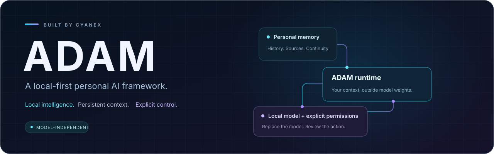
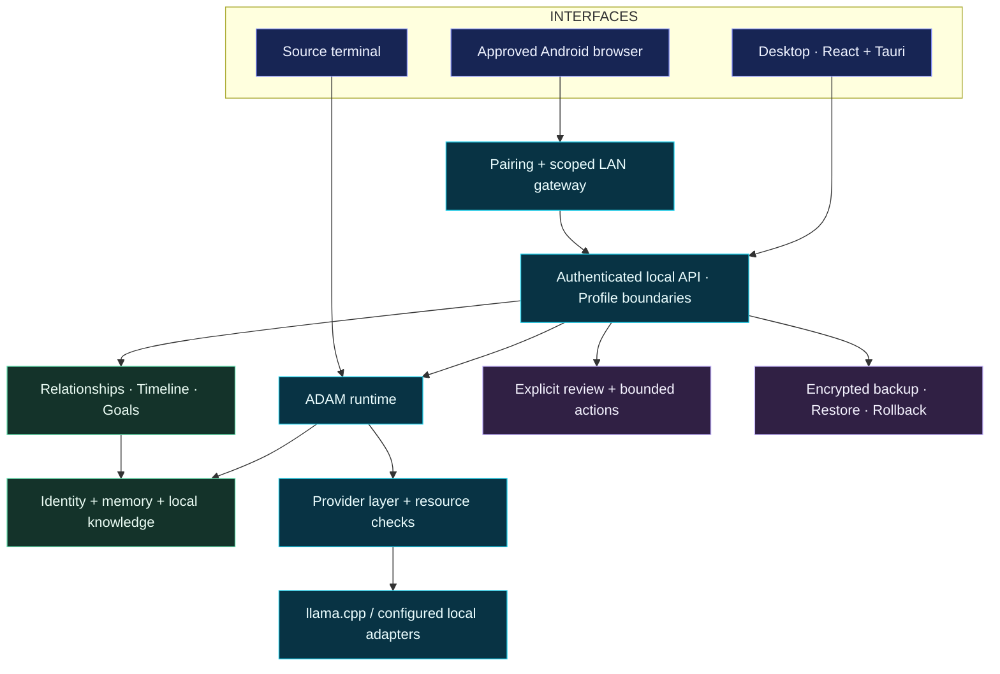
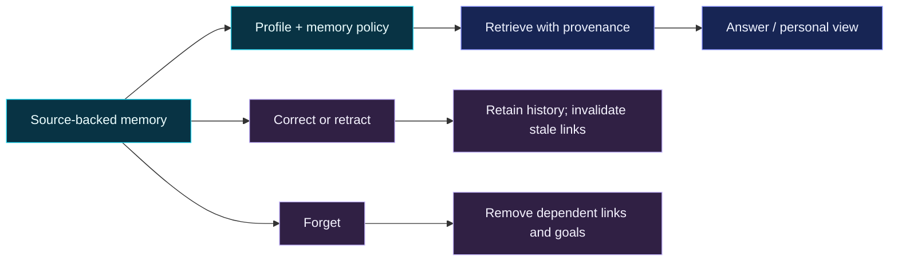

<div align="center">



**A local-first personal AI framework by Cyanex.**

Persistent memory · Private knowledge · Replaceable models · Reviewed actions


[Quick start](#quick-start) · [Features](#what-adam-can-do) · [Architecture](#how-it-fits-together) · [Development](#build-from-source) · [Documentation](#explore-the-project)

</div>

---

## Your context, beyond a single conversation

ADAM keeps identity, memory, knowledge and permissions in the application layer,
outside model weights. Conversations can carry context forward, retrieved answers
can point back to their sources, and personal facts can be corrected or forgotten.
The model is replaceable; your personal state has its own lifecycle.

Local inference is the default path. Internet features and external integrations
are opt-in, and supported computer actions require explicit review.

## What ADAM can do

| | Capability | What you get |
| :---: | :--- | :--- |
| 🧠 | **Memory with history** | Persistent conversations, explicit memories, corrections, provenance and forgetting. |
| 📚 | **Knowledge with sources** | Local document ingestion and cited retrieval; keyword search works without optional semantic models. |
| 🔗 | **Personal intelligence** | Evidence-linked relationships, searchable timelines, tracked goals and clearly labeled routine suggestions. |
| 🛠️ | **Actions with review** | Reviewed tools, tasks and reminders, plus bounded **See → Plan → Act → Verify** workflows for supported Win32 controls. |
| 🖥️ | **Multiple interfaces** | A React/Tauri desktop, source terminal, local voice and an approved Android browser client with separate setup. |
| 📦 | **Recovery and portability** | Encrypted backups, staged restore, model resource checks, managed updates and rollback. |

Owner, guest and fictional demo profiles have separate access boundaries. The demo
includes synthetic projects and a scoped note sandbox for trying write, verify and
undo without using owner data.

## Quick start

### Complete offline bundle

Use **`ADAM-0.20.0-Source-With-Model.zip`** for the preconfigured source experience.

1. **Extract the entire ZIP** into a writable folder.
2. **Double-click `RUN_ADAM.bat`** to open the source terminal.
3. Start chatting. Enter **`/quit`** to exit and stop the owned model server.

Use **`RUN_DEMO.bat`** to open a separate fictional profile instead.

> The full bundle includes Python, llama.cpp and the verified **Qwen3-4B Q4_K_M**
> chat model. No global Python installation or pip download is needed. The first
> launch verifies the model checksum. The desktop app is a separate build.

<details>
<summary><strong>Inside the bundle</strong></summary>

```text
ADAM/
├── RUN_ADAM.bat         One-click editable source terminal
├── RUN_DEMO.bat         Fictional demo profile
├── backend/adam/        Python application source
├── apps/desktop/        React + Tauri desktop source
├── models/              Chat model, checksum and upstream notices
├── runtime/
│   ├── python/          Bundled interpreter and dependencies
│   └── llama/           Local inference runtime
└── data/                Private state, created on first use
```

The bundled CPU profile uses **3 threads**, a **2,048-token context** and up to
**384 output tokens**. Performance depends on available memory and other running
applications. Optional speech, speaker, semantic-search and vision models are
separate assets; the bundle includes the default chat model.

</details>

### Try memory and personal context

```text
/remember preference editor = Example Studio
/correct editor = Another Editor
/show memory --history editor
/why know editor
/forget editor
```

In the fictional demo, explore the supplied project context:

```text
/graph Cedar
/timeline Cedar
/goals
/briefing
```

## How it fits together



The terminal is a trusted local entry point. Desktop and mobile requests pass
through their authentication and profile boundaries. Ordinary model output has no
direct authority to operate the computer; action providers check permissions and
state separately. See the [architecture](docs/public/ARCHITECTURE.md) and
[threat model](docs/public/THREAT_MODEL.md) for the full contracts.

## Memory you can inspect and change



Relationships annotate supporting memories; they cannot override their evidence.
Historical facts stay distinguishable from current facts. Routine suggestions stay
**inferred**, and briefings are requested manually. Personal intelligence remains
subject to the same privacy and forgetting rules as its sources.

## Build from source

The **GitHub source ZIP or checkout** excludes model weights, runtime binaries and
personal data. It needs an initial dependency and model setup. Use **Python 3.13**
on **Windows x64**.

```powershell
# From the repository root: install the locked development environment.
.\scripts\dev.ps1 -Install -Command init

# Download and verify the pinned chat model and inference runtime.
.\scripts\setup-model.ps1

# Start the source terminal with CPU inference.
.\scripts\start.ps1 -Cpu
```

The helper manages its environment under `%LOCALAPPDATA%\ADAM\dev-env`. For a
manually managed environment, use `requirements.lock.txt` and install the project
with `python -m pip install -e .`.

<details>
<summary><strong>Desktop frontend development</strong></summary>

```powershell
cd apps/desktop
npm ci
npm run dev
```

The development server alone is a frontend preview. Normal application operation
uses the native desktop bridge; follow the [desktop guide](docs/operations/desktop.md)
for native setup and builds.

</details>

## Tested, with scope attached

The **0.20.0 release verification** includes:

| Verification | Recorded result |
| :--- | :--- |
| Python regression suite | **463 tests passed** |
| Frontend / native Rust tests | **12 / 3 passed** |
| Live source / frozen service checks | **48 / 48 passed** |
| Scripted framework and security evaluation | **22 cases · 0 critical failures** |
| Offline source bundle | **Real Qwen CPU test + fresh ZIP extraction and BAT startup passed** |

These are recorded release results, not live CI badges. The 22-case benchmark
uses scripted framework probes and does **not** measure general LLM quality.
Unavailable VRAM and voice measurements remain unavailable. Human acceptance,
clean-VM and alternate-hardware validation are tracked separately.

<details>
<summary><strong>Run the source checks</strong></summary>

Run these with the project's locked development environment:

```powershell
python -m pytest -q
python -m ruff check backend tests
python -m mypy backend/adam
python -m adam.evals.runner --suite full --summary
```

The evaluation transport is scripted unless real-model mode is explicitly selected.
See [evaluation methodology](docs/public/EVALUATION.md) for modes, evidence and limits.

</details>

> **Experimental training:** the opt-in synthetic dataset builder, GPU recipe and
> comparison workflow are implemented. Actual LoRA/QLoRA training is deferred;
> no validated fine-tuned adapter is included or active.

## Explore the project

| Understand the design | Run and extend ADAM |
| :--- | :--- |
| [Architecture](docs/public/ARCHITECTURE.md) | [Desktop setup](docs/operations/desktop.md) |
| [Threat model](docs/public/THREAT_MODEL.md) | [Demo and delivery](docs/operations/portfolio.md) |
| [Evaluation methodology](docs/public/EVALUATION.md) | [Setup, updates and restore](docs/operations/distribution.md) |
| [Known limitations](docs/public/LIMITATIONS.md) | [Personal intelligence](docs/operations/personal-intelligence.md) |
| [Roadmap](PROJECT_ADAM_ROADMAP.md) | [Computer-action scope](docs/operations/computer-actions.md) |
| [Contribution guide](CONTRIBUTING.md) | [Voice](docs/operations/voice.md) · [Speakers](docs/operations/speakers.md) · [Android](docs/operations/mobile-mesh.md) |
| [Security reporting](SECURITY.md) | [Behavior training experiment](docs/operations/behavior-training.md) |

## License

Copyright © 2026 **Cyanex**. ADAM is source-available under the
[Community Non-Commercial License v1.0](LICENSE). Commercial use requires prior
written authorization or a separate commercial license. Read the contribution
terms before submitting changes. Third-party models and runtimes retain their own
licenses; see [third-party notices](THIRD_PARTY.md).

**Commercial licensing:** [maliksaad277@email.com](mailto:maliksaad277@email.com)
· [Cyanex on GitHub](https://github.com/Cyanex1702)

---

<div align="center">

**ADAM** · Local intelligence. Persistent context. Explicit control.

</div>
