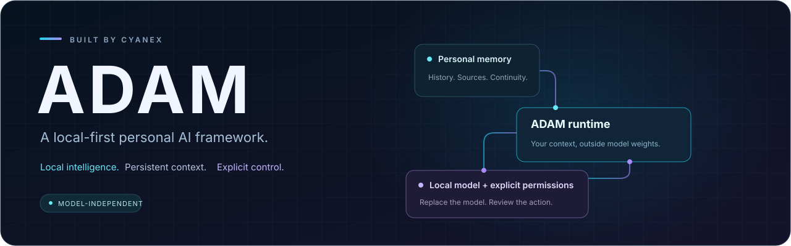
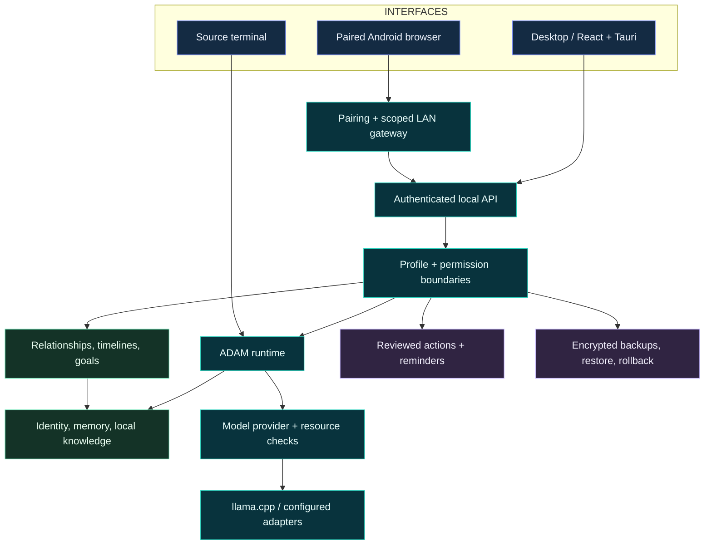
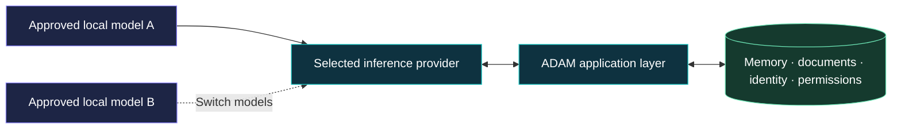
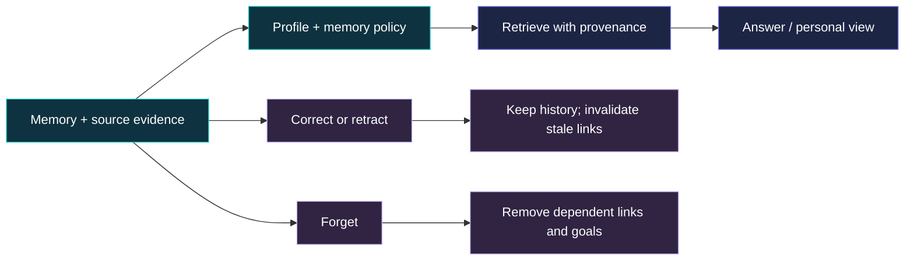

<div align="center">



### A local-first personal AI for Windows

**Chat locally. Keep your context. Use the model you choose.**

[](#release-verification)
[](#quick-start)
[](#build-from-source)
[](#interfaces-and-extra-setup)
[](#license)

[**Explore features**](#features-at-a-glance) · [**Quick start**](#quick-start) · [**Architecture**](#under-the-hood) · [**Build from source**](#build-from-source) · [**Docs**](#documentation)

<sub>Made by <strong>Cyanex</strong> · Local inference by default · Network features opt-in</sub>

</div>

---

## AI that remembers beyond the current chat

ADAM is a **local-first personal AI application**, not just a chat window around a model. It can stream local responses, save and resume conversations, remember and correct personal context, answer questions about supported local documents with source references, and work with approved models on your device.

With additional setup, ADAM also supports voice, OCR, Android browser access, opted-in web research and bounded computer actions with explicit review. The key design decision is that **memory, knowledge, identity and permissions belong to ADAM, not to the model weights**. Switching models does not mean starting over.

<table>
<tr>
<td align="center" width="25%"><strong>🧠 Memory with history</strong><br/><sub>Keep, correct, trace or forget facts</sub></td>
<td align="center" width="25%"><strong>📚 Knowledge with sources</strong><br/><sub>Ask your own local documents</sub></td>
<td align="center" width="25%"><strong>🔁 Replaceable models</strong><br/><sub>Choose from approved GGUF models</sub></td>
<td align="center" width="25%"><strong>🔐 Explicit control</strong><br/><sub>Opt in to network and review actions</sub></td>
</tr>
</table>

## Features at a glance
### Explore the capabilities

| | Capability | What ADAM can do |
| :---: | :--- | :--- |
| 💬 | **Local AI chat** | Run a local language model, stream replies and resume saved chats. Optional **Careful mode** uses two passes to review the question and answer. |
| 🧠 | **Persistent memory** | Save preferences and facts, correct stale information, inspect provenance and forget information on request. Memory persists across model switches. |
| 📚 | **Document Q&A** | Import supported local files and answer with source references. Keyword search works without a separate embedding model. |
| 🔗 | **Personal context** | Explore evidence-linked relationships, timelines, goals and on-demand briefings. Inferred routines are labeled suggestions. |
| 📦 | **Local model library** | Scan supported folders for **GGUF** models, approve and switch models, or use selection based on task complexity and available memory. |
| ⚙️ | **Performance controls** | Choose **CPU or Vulkan GPU** inference, toggle **Eco / Priority** and inspect model-loading state, queues and resources. |
| 🎙️ | **Voice** | Transcribe locally, review speech before sending and read responses aloud. Conversation mode and speaker recognition need extra setup. |
| 👁️ | **Image / window text** | OCR images or a specifically selected Windows application window. General image understanding needs a configured vision model. |
| ⏰ | **Reminders** | Schedule reminders, receive them in the inbox and use a visible background tray indicator. |
| 🌐 | **Internet research** | Opt in to supported search providers, fetch public HTTPS pages and use a text browser. Regular chat stays local by default. |
| 📱 | **Android access** | Pair an Android browser over the local network. The phone client has fewer permissions than the desktop owner. |
| 🔐 | **Profiles & privacy** | Separate owner, guest and fictional demo profiles, with owner authentication and credential vault support. |
| 🩺 | **Diagnostics & recovery** | Inspect service, model, resource and storage health; export privacy-scoped diagnostics; create encrypted backups, restore in stages and use supported update rollback. |
| 🧪 | **Behavior experiments** | Review synthetic examples, export a training dataset and recipe, and compare evaluation reports. Training itself is a separate process. |
| 🛠️ | **Reviewed computer actions** | Approve supported tool operations and bounded **See → Plan → Act → Verify** workflows on supported Win32 controls. |

> [!NOTE]
> This table describes the **application's capabilities**, not a promise that every one is active in the offline starter bundle. Some features require separately installed models, supported hardware, the native desktop app, provider configuration or explicit approval. See [interfaces and extra setup](#interfaces-and-extra-setup).

## What makes ADAM different

<table>
<tr>
<td width="50%" valign="top">
<h3>🧠 Context independent of the model</h3>
<p>Keep conversations, memories and evidence in ADAM's application layer. Correct a preference, trace where it came from, or forget it. Then switch between approved models without moving your personal state into the model itself.</p>
</td>
<td width="50%" valign="top">
<h3>📖 Answers you can trace</h3>
<p>Search supported local documents and follow source references. Keyword retrieval works even without an optional semantic embedding model. Linked personal context is grounded in supporting memories rather than treated as unquestionable fact.</p>
</td>
</tr>
<tr>
<td valign="top">
<h3>🧰 More than text chat</h3>
<p>Optional speech, OCR, reminders, model controls, research and paired Android access make ADAM useful in different contexts. Capabilities are gated by their interface, permissions and installed components.</p>
</td>
<td valign="top">
<h3>🛡️ Explicit boundaries</h3>
<p>Ordinary inference stays on-device by default. Internet access is opt-in. Mobile is permission-scoped. Supported computer actions require review; model output alone does not get to operate your computer.</p>
</td>
</tr>
</table>

## Quick start

### Option A: complete offline source bundle

Use **`ADAM-0.20.0-Source-With-Model.zip`** for the preconfigured **source terminal** experience on Windows x64.

1. **Extract the complete ZIP** to a writable folder.
2. **Double-click `RUN_ADAM.bat`**.
3. Chat locally. Enter **`/quit`** to exit and shut down the model server started by the launcher.

For a separate profile with fictional project data, launch **`RUN_DEMO.bat`** instead.

> [!IMPORTANT]
> The full offline bundle includes Python, llama.cpp and a verified **Qwen3-4B Q4_K_M** chat model. It needs no global Python install or pip download. The first launch checks the model checksum. **The React/Tauri desktop application is a separate build**; the ZIP starts the source terminal.

<details>
<summary><strong>What's inside the bundle?</strong></summary>

```text
ADAM/
├── RUN_ADAM.bat         One-click editable source terminal
├── RUN_DEMO.bat         Fictional demo profile
├── backend/adam/        Python application source
├── apps/desktop/        React + Tauri desktop source
├── models/              Chat model, checksum and upstream notices
├── runtime/
│   ├── python/          Bundled interpreter and dependencies
│   └── llama/           Local inference runtime
└── data/                Private state, created on first use
```

The bundled CPU profile uses **3 threads**, a **2,048-token context** and up to **384 output tokens**. Performance depends on your machine and other running applications. Speech, speaker, semantic-search and vision models are not part of the default chat-model bundle.

</details>

### Try it: memory that you can inspect

```text
/remember preference editor = Example Studio
/correct editor = Another Editor
/show memory --history editor
/why know editor
/forget editor
```

The fictional demo also includes example project context:

```text
/graph Cedar
/timeline Cedar
/goals
/briefing
```

### Option B: build from source

The **GitHub checkout/source ZIP** does **not** include runtime binaries, model weights or personal data. See [build from source](#build-from-source) to install dependencies and the model.

## Under the hood

### How the pieces connect



The **terminal is a trusted local entry point**. Desktop and Android requests pass through authentication and profile boundaries. Model-generated text does not itself authorize computer operations; separate action providers check permissions and state. See the [architecture specification](docs/public/ARCHITECTURE.md) and [threat model](docs/public/THREAT_MODEL.md).

### Model changes should not erase your memory



The model processes requests. **ADAM keeps the user's state**. Model selection can change without migrating stored personal context into a new set of weights.

### Memory with provenance and forgetting



Relationships point back to supporting memories rather than overriding evidence. Historical facts remain distinguishable from current facts; routines are **suggestions**, not established facts. Briefings are requested manually, and derived personal context follows the same correction and forgetting rules.

## Interfaces and extra setup

| Component | What to know |
| :--- | :--- |
| **Offline starter bundle** | Provides the source terminal, Python, llama.cpp and default verified chat model. |
| **Desktop UI** | React + Tauri requires its native setup/build. A frontend dev preview alone is **not** the native desktop application. |
| **Voice / speaker features** | Optional speech and speaker assets must be configured separately; conversation mode and speaker recognition require additional setup. |
| **OCR / vision** | OCR extracts text from a chosen image or window. Full image interpretation requires a separate vision model. |
| **Semantic search** | Optional; local document keyword retrieval works without embeddings. |
| **Vulkan GPU** | Depends on supported hardware and Vulkan-capable runtime configuration; CPU is supported. |
| **Internet research** | Requires opted-in provider configuration; ordinary chat remains local by default. |
| **Android browser** | Requires pairing and a scoped local-network gateway; its permissions differ from the desktop owner's. |
| **Reviewed Win32 actions** | Only supported controls/workflows; operations are bounded and require explicit review. |
| **Behavior training** | Synthetic dataset generation, recipe export and evaluation comparisons are available; actual LoRA/QLoRA training is separate and **not validated as an included fine-tuned adapter**. |

The demo profile contains fictional projects and a scoped note sandbox for practicing write, verify and undo without owner data.

## Build from source

Requires **Windows x64** and **Python 3.13**.

```powershell
# From the repository root: install the locked dev environment.
.\scripts\dev.ps1 -Install -Command init

# Download and verify the pinned model and inference runtime.
.\scripts\setup-model.ps1

# Launch the source terminal with CPU inference.
.\scripts\start.ps1 -Cpu
```

The helper creates its environment under `%LOCALAPPDATA%\ADAM\dev-env`. Alternatively, use `requirements.lock.txt` and `python -m pip install -e .` in a manually managed environment.

<details>
<summary><strong>Frontend development</strong></summary>

```powershell
cd apps/desktop
npm ci
npm run dev
```

The dev server is **only a frontend preview**. Follow the [desktop setup guide](docs/operations/desktop.md) for the native bridge and builds.

</details>

## Release verification

The **v0.20.0** release records the following checks:

| Check | Recorded result |
| :--- | :--- |
| Python regression suite | **463 passed** |
| Frontend / native Rust tests | **12 / 3 passed** |
| Live source / frozen service checks | **48 / 48 passed** |
| Scripted framework + security evaluation | **22 cases, 0 critical failures** |
| Offline source bundle | **Real Qwen CPU test; fresh ZIP extraction and BAT startup passed** |

> [!CAUTION]
> These are recorded release results, **not live CI status**. The 22-case benchmark tests scripted framework and security probes, **not general LLM quality**. VRAM and voice measurements were unavailable; human acceptance, clean-VM and alternate-hardware validation are tracked separately.

<details>
<summary><strong>Run the checks yourself</strong></summary>

Use the project's locked development environment:

```powershell
python -m pytest -q
python -m ruff check backend tests
python -m mypy backend/adam
python -m adam.evals.runner --suite full --summary
```

The evaluation runner uses scripted transport unless real-model mode is selected. More detail: [evaluation methodology](docs/public/EVALUATION.md).

</details>

## Documentation

| Explore ADAM | Set up and extend it |
| :--- | :--- |
| [Architecture](docs/public/ARCHITECTURE.md) | [Desktop setup](docs/operations/desktop.md) |
| [Threat model](docs/public/THREAT_MODEL.md) | [Demo and delivery](docs/operations/portfolio.md) |
| [Evaluation methodology](docs/public/EVALUATION.md) | [Distribution, restore and updates](docs/operations/distribution.md) |
| [Known limitations](docs/public/LIMITATIONS.md) | [Personal intelligence](docs/operations/personal-intelligence.md) |
| [Roadmap](PROJECT_ADAM_ROADMAP.md) | [Computer action scope](docs/operations/computer-actions.md) |
| [Contributing](CONTRIBUTING.md) | [Voice](docs/operations/voice.md) · [Speakers](docs/operations/speakers.md) · [Android](docs/operations/mobile-mesh.md) |
| [Security reporting](SECURITY.md) | [Behavior training experiments](docs/operations/behavior-training.md) |

## License

Copyright © 2026 **Cyanex**. ADAM is **source-available**, licensed under the [Community Non-Commercial License v1.0](LICENSE). **Commercial use requires written permission or a separate commercial license.** Review contribution terms before contributing; third-party models and runtimes have their own terms in [THIRD_PARTY.md](THIRD_PARTY.md).

Commercial licensing: [maliksaad277@email.com](mailto:maliksaad277@email.com) · [Cyanex on GitHub](https://github.com/Cyanex1702)

---

<div align="center">

**ADAM** · Local intelligence. Persistent context. Explicit control.

<sub>Built to keep your context with you, even when the model changes.</sub>

</div>
