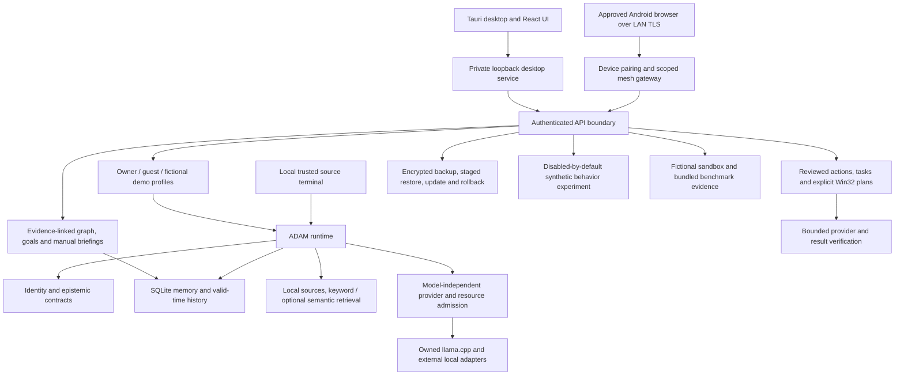

# Architecture

ADAM separates personal state and permissions from replaceable model weights.

The SQLite runtime database contains versioned memory, conversations, knowledge
metadata and personal structures. Foreign keys bind relationships/goals to source
memory; forgetting cascades to dependent structures. Other subsystems retain their
own bounded stores. Portable backups preserve source data and omit derived indexes
and device secrets. Restore revokes sessions and resets device/training consent.

Models produce text; ordinary chat has no direct computer-action authority.
Explicit action providers validate permissions and current state separately.
The personal graph is an annotation layer and cannot override source evidence.
Screenshots/OCR do not become trusted instructions. Trace events store bounded
metadata rather than hidden reasoning or chat payloads.

The source-with-model bundle runs editable `backend/adam` Python using a copied,
relocatable Python runtime. It places weights in `models`, llama.cpp in
`runtime/llama`, and new local state in `data`. The desktop installer is separate:
it contains a frozen backend and compiled frontend. Both share runtime contracts.
